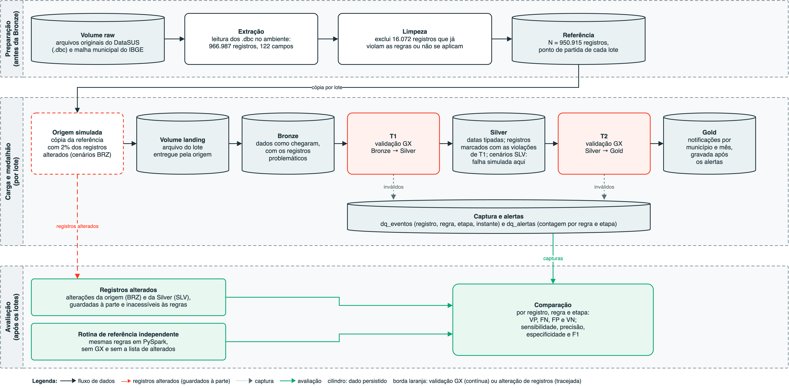

# Observabilidade da qualidade de dados em pipelines de processamento em lote com Great Expectations

Material de reprodução do experimento do Trabalho de Conclusão de Curso da Especialização em Engenharia
de Dados e Big Data (PECE, Escola Politécnica da USP, 2026).

- **Autor:** Wellington Antonio de Oliveira Costa
- **Orientador:** Wesley Lourenço Barbosa
- **Execução de referência:** `EXP-2026-10-04` (4 de outubro de 2026), regras na versão `R-1.0`

## Resumo do experimento

Pipeline em lote nas camadas Bronze, Silver e Gold, com verificações de qualidade em Great Expectations
(GX Core 1.23.2) em dois pontos: **T1** (Bronze → Silver) e **T2** (Silver → Gold). Os dados são os
microdados do Sinan de chikungunya (Brasil, 2022 a 2024).

| Item | Valor |
|---|---|
| Base extraída | 966.987 registros, 122 campos |
| Referência após a limpeza (N) | 950.915 registros |
| Registros alterados por lote (m) | 19.018 (piso de 2% de N) |
| Lotes | 50 (5 controles + 9 cenários com defeito × 5 sementes) |
| Sementes | 42 a 46; ordem dos lotes com semente 2026 |
| Regras | R_CPL (completude), R_CNF (conformidade), R_VAL (validade), R_UNI (unicidade) |
| Origem dos defeitos | BRZ (recebido da origem) e SLV (falha na transformação Bronze → Silver) |
| Resultado | sensibilidade, precisão, especificidade e F1 = 1,0000 no ponto esperado, em todos os cenários |

Os registros sinalizados **não são bloqueados**: as ocorrências são gravadas em `dq_eventos` e os alertas
são persistidos antes da materialização da Gold.



## Estrutura

```
dados/        arquivos de origem (DATASUS) e domínio municipal (IBGE)
notebooks/    código executado no Databricks (idêntico ao da execução de referência)
job/          definição do job (4 tarefas encadeadas, serverless)
resultados/   tabelas exportadas da execução (matrizes, precedência, rastreabilidade, manifestos)
evidencias/   capturas de tela da execução
docs/         diagrama da arquitetura (.drawio editável e .png)
SHA256SUMS    hashes dos arquivos de dados
```

### Notebooks

| Notebook | Função |
|---|---|
| `00_comum.py` | parâmetros, regras GX congeladas, rotina de referência independente, transformações e injeção de defeitos |
| `01_preparacao.py` | extração dos `.dbc`, diagnóstico da base extraída, limpeza e manifesto de aquisição |
| `02_verificacao_regras.py` | 14 casos-limite (27 verificações) no GX e na rotina de referência |
| `03_execucao_lotes.py` | execução dos 50 lotes: landing → Bronze → T1 → Silver → T2 → Gold |
| `04_avaliacao.py` | matrizes, métricas, concordância, precedência e rastreabilidade |

No código, a rotina de referência independente aparece com o nome provisório **oráculo**
(ex.: coluna `obtido_oraculo`). No texto do TCC ela é chamada de "rotina de referência independente".

## Dados

| Arquivo | Fonte | Obtido em |
|---|---|---|
| `CHIKBR22.dbc`, `CHIKBR23.dbc`, `CHIKBR24.dbc` | FTP do DATASUS, `ftp://ftp.datasus.gov.br/dissemin/publicos/SINAN/DADOS/FINAIS/` | 2026-09-06 |
| `ibge_cod6.txt` (5.571 códigos de 6 dígitos) | API de localidades do IBGE, `https://servicodados.ibge.gov.br/api/v1/localidades/municipios` | 2026-09-06 |

Os microdados são públicos e anonimizados. Como os dados finais do Sinan podem ser atualizados, um download
posterior pode gerar arquivos diferentes; confira com `shasum -a 256 -c SHA256SUMS` dentro de `dados/`.
Os registros alterados pelo experimento existem apenas nas tabelas geradas e não devem ser usados como dados
epidemiológicos.

## Como reproduzir

Requisitos: workspace Databricks com Unity Catalog e computação serverless (ambiente de referência:
Databricks em AWS, Runtime 19.9.x, Apache Spark 4.2.0, Python 3.12.3).

1. Crie o schema `tcc_dq_exp` e os volumes `raw`, `landing` e `resultados` em um catálogo seu.
2. Copie o conteúdo de `dados/` para o volume `raw`.
3. Importe os notebooks para uma pasta do workspace e, em `00_comum.py`, ajuste `CATALOG`
   (na execução de referência, `well_costa_classic_stable_catalog`).
4. Crie o job a partir de `job/job-settings.json`, trocando `<PASTA_NO_WORKSPACE>` pela pasta dos notebooks.
   O ambiente do job instala `great_expectations==1.23.2` e `pyreaddbc==2.0.4`.
5. Execute o job. A execução de referência levou cerca de 1h50min.

Os resultados ficam nas tabelas do schema e são exportados como CSV para o volume `resultados`.

## Observações

- O notebook `03_execucao_lotes.py` tem um módulo opcional de medição de tempo (`modulo_tempo`). Essas
  medições não fazem parte da análise do TCC e não estão em `resultados/`.
- `resultados/amostra_*.csv` são amostras; as tabelas completas (por exemplo, 1.616.886 ocorrências em
  `dq_eventos`) são geradas pela execução.
